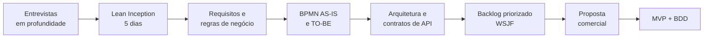

# Portal do Titular — Autoatendimento LGPD da Aurora Varejo

> Estudo de caso completo de **análise de negócios e engenharia de requisitos**: da descoberta com a diretoria até a proposta comercial, a especificação da API e um MVP funcional com critérios de aceite em BDD.

**Empresa fictícia:** Aurora Varejo, rede com 120 lojas e 4,2 milhões de clientes no programa de fidelidade **Aurora+**.

**Problema:** pedidos de titulares de dados (acesso, correção, exclusão, portabilidade, revogação de consentimento) chegam por e-mail, SAC e redes sociais, são tratados manualmente pelo time do DPO numa planilha e **38% estouram o prazo de 15 dias** previsto na LGPD.

**Solução proposta:** um portal de autoatendimento onde o próprio cliente abre, acompanha e recebe a resposta das solicitações, com orquestração automática entre CRM, ERP e plataforma de marketing.

---

## O que este projeto demonstra

| Competência | Onde ver |
|---|---|
| Contexto, stakeholders e entrevistas em profundidade | [01 — Contexto e descoberta](docs/01-contexto-e-descoberta.md) |
| Lean Inception e Design Thinking (workshop com a diretoria) | [02 — Lean Inception](docs/02-lean-inception.md) |
| Requisitos funcionais, não-funcionais, regras de negócio, restrições e rastreabilidade | [03 — Requisitos](docs/03-requisitos.md) |
| Modelagem BPMN AS-IS e TO-BE | [04 — Processos BPMN](docs/04-processos-bpmn.md) |
| Arquitetura funcional, integrações e análise de impacto | [05 — Arquitetura e integrações](docs/05-arquitetura-e-integracoes.md) |
| Backlog, fatiamento, MoSCoW, RICE e WSJF | [06 — Backlog e priorização](docs/06-backlog-e-priorizacao.md) |
| Pré-venda, estimativa, precificação e proposta | [07 — Proposta comercial](docs/07-proposta-comercial.md) |
| Governança Scrum/Kanban e gestão de mudanças | [08 — Gestão ágil](docs/08-gestao-agil.md) |
| Contrato de API (OpenAPI 3) | [api/openapi.yaml](api/openapi.yaml) |
| Critérios de aceite em BDD (Gherkin) | [features/](features/) |
| MVP funcional em Python que implementa as regras de negócio | [app/](app/) e [tests/](tests/) |

---

## Linha do tempo do caso



## Resultados esperados (metas acordadas com a diretoria)

- Solicitações respondidas dentro do prazo legal: **de 62% para 98%**
- Tempo médio de atendimento: **de 11 para 3 dias**
- Esforço manual do time do DPO: **redução de 70%**
- 100% das solicitações com trilha de auditoria para fiscalização da ANPD

---

## Rodando o MVP

Requisitos: Python 3.10+.

```bash
python -m venv .venv
source .venv/bin/activate
pip install -r requirements.txt
python -m app.main
```

A API sobe em `http://localhost:5000`. Exemplo:

```bash
curl -X POST http://localhost:5000/v1/solicitacoes \
  -H "Content-Type: application/json" \
  -d '{"cpf": "52998224725", "email": "ana@email.com", "tipo": "ACESSO"}'
```

Testes (cada teste referencia a regra de negócio que valida):

```bash
python -m unittest discover -s tests -v
```

### Cobertura dos critérios de aceite

| Feature | Status no MVP |
|---|---|
| `abertura_de_solicitacao.feature` | Automatizada em `tests/test_regras.py` |
| `validacao_de_identidade.feature` | Automatizada em `tests/test_regras.py` |
| `prazos_e_alertas.feature` | Automatizada em `tests/test_regras.py` |
| `revogacao_de_consentimento.feature` | Especificada; depende da integração INT04 |
| `exclusao_de_dados.feature` | Especificada; onda 2 |

Os nomes dos testes começam com o código do requisito ou da regra (`test_rn05_...`), fechando a rastreabilidade de ponta a ponta: **achado → requisito → regra → história → cenário → teste**.

## Estrutura

```
portal-do-titular/
├── README.md
├── docs/            estudo de caso, requisitos, BPMN, backlog e proposta
├── api/             contrato OpenAPI 3
├── features/        critérios de aceite em Gherkin (BDD)
├── app/             MVP em Flask com as regras de negócio isoladas
└── tests/           testes automatizados rastreados às regras
```

---

**Autor:** Fernando Negreiro — [github.com/FerNegreiro](https://github.com/FerNegreiro)

*Empresa, pessoas e números são fictícios, criados para fins de portfólio.*
