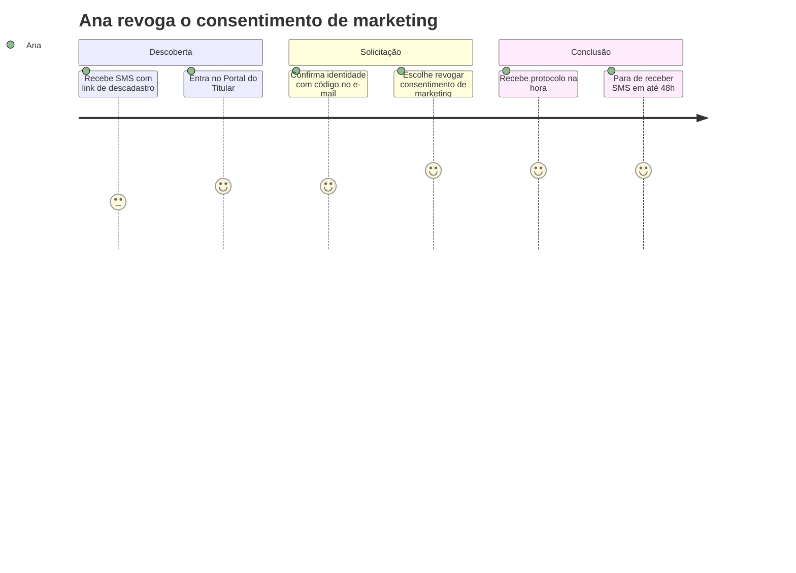

# 02 — Lean Inception

Workshop de 5 dias com a diretoria jurídica, DPO, TI, CRM e SAC, seguindo o formato de Paulo Caroli, com dinâmicas de Design Thinking para cocriação.

## Agenda

| Dia | Manhã | Tarde |
|---|---|---|
| 1 | Visão do produto | É / Não é / Faz / Não faz |
| 2 | Objetivos do produto | Personas |
| 3 | Jornadas do usuário | Brainstorming de funcionalidades |
| 4 | Revisão técnica, de negócio e UX | Sequenciador de funcionalidades |
| 5 | Canvas MVP | Apresentação para a diretoria |

## Visão do produto

> **Para** clientes da Aurora Varejo
> **que** querem saber e controlar o que a empresa faz com seus dados,
> **o** Portal do Titular
> **é um** canal de autoatendimento
> **que** permite abrir, acompanhar e receber a resposta de qualquer direito previsto na LGPD em poucos cliques.
> **Diferente de** e-mails e ligações ao SAC sem protocolo,
> **o nosso produto** valida a identidade, cumpre o prazo legal automaticamente e guarda prova de cada etapa.

## É / Não é / Faz / Não faz

| É | Não é |
|---|---|
| Canal oficial para direitos do titular | Central de atendimento geral |
| Autoatendimento com acompanhamento | Ferramenta interna do DPO apenas |
| Registro auditável | Substituto do jurídico |

| Faz | Não faz |
|---|---|
| Valida identidade antes de expor dados | Altera preços, pedidos ou trocas |
| Orquestra exclusão em todos os sistemas | Exclui dados que a lei obriga a guardar |
| Controla prazos e alerta o DPO | Responde dúvidas genéricas sobre produtos |

## Personas

**Ana, 34 anos, cliente Aurora+.** Recebe SMS de promoção demais e quer revogar o consentimento de marketing sem sair do programa. Usa o celular para tudo e desiste se o processo tiver mais de 3 telas.

**Carlos, 58 anos, ex-cliente.** Quer que a empresa apague todos os dados dele. Desconfia de formulários online e prefere ter um número de protocolo.

**Juliana, 41 anos, DPO.** Precisa provar para a ANPD que cada pedido foi cumprido dentro do prazo. Hoje passa metade da semana cobrando outras áreas.

## Jornada da Ana (TO-BE)

## Sequenciador e Canvas MVP

| Onda | Funcionalidades | Por quê |
|---|---|---|
| **MVP (onda 1)** | Abertura de solicitação, validação de identidade por código, confirmação e acesso, revogação de consentimento, painel de prazos do DPO | Resolve 72% do volume atual |
| Onda 2 | Exclusão orquestrada, correção de dados, trilha de auditoria exportável | Maior complexidade de integração |
| Onda 3 | Portabilidade, informações sobre compartilhamento, atendimento no app | Volume baixo hoje |

**Hipótese do MVP:** se o titular puder abrir e acompanhar pedidos de acesso e revogação sozinho, com identidade validada, o percentual de pedidos dentro do prazo passa de 62% para pelo menos 90% em 60 dias.

**Métricas de validação:** % no prazo, tempo médio de resposta, % de pedidos abertos pelo portal versus outros canais, nota de satisfação ao final da jornada.
