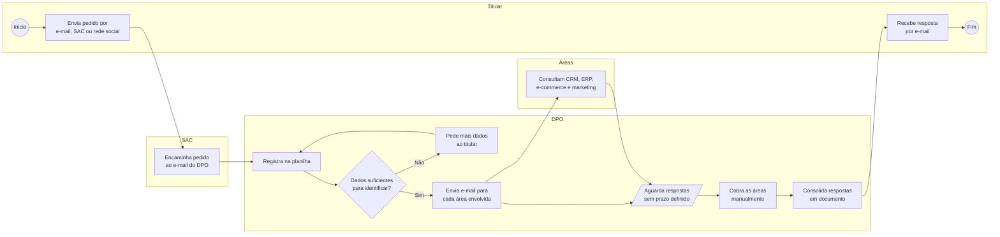
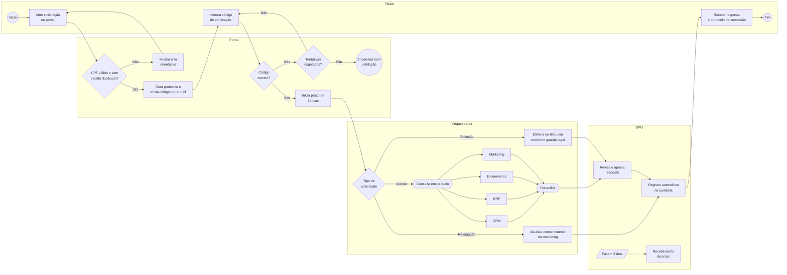

# 04 — Processos (BPMN)

Os diagramas abaixo usam Mermaid para renderizar direto no GitHub, mantendo a semântica BPMN: cada bloco de raia representa uma **lane**, losangos são **gateways** e círculos são **eventos**.

| Símbolo aqui | Elemento BPMN |
|---|---|
| `(( ))` | Evento de início ou fim |
| `[ ]` | Tarefa |
| `{ }` | Gateway exclusivo (XOR) |
| `{{ }}` | Gateway paralelo (AND) |
| `[/ /]` | Evento intermediário de tempo |

## AS-IS — Atendimento de pedido de titular

### Problemas identificados no AS-IS

| # | Etapa | Problema | Desperdício (Lean) |
|---|---|---|---|
| P1 | Entrada multicanal | Sem protocolo e sem formulário padrão | Defeito |
| P2 | Identificação | Volta e meia com o titular para pedir dados | Retrabalho |
| P3 | Sem validação de identidade | Risco de enviar dados para outra pessoa | Defeito crítico |
| P4 | Envio por e-mail às áreas | Espera sem prazo nem dono | Espera |
| P5 | Cobrança manual | Tempo do DPO gasto em follow-up | Movimentação |
| P6 | Sem registro de conclusão | Nenhuma prova para auditoria | Defeito |

## TO-BE — Portal do Titular

## Comparativo

| Indicador | AS-IS | TO-BE (meta) |
|---|---|---|
| Etapas manuais | 9 | 2 (revisão e aprovação) |
| Pontos de espera sem dono | 3 | 0 |
| Validação de identidade | Não existe | Código por e-mail |
| Rastreabilidade | Planilha | Auditoria automática por evento |
| Tempo médio | 11 dias | 3 dias |

## Ferramentas

A modelagem de referência foi feita para ser levada ao **Bizagi Modeler** (documentação e simulação de capacidade) e ao **Camunda Modeler**, onde o TO-BE pode virar processo executável com o orquestrador como *service tasks* e o alerta de prazo como *timer boundary event*.
