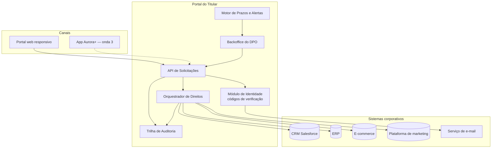

# 05 — Arquitetura funcional e integrações

## Visão de módulos

| Módulo | Responsabilidade | Dono |
|---|---|---|
| API de Solicitações | Abertura, consulta e mudança de status | Squad Portal |
| Identidade | Gerar, enviar e validar códigos (RN05) | Squad Portal |
| Orquestrador | Disparar e acompanhar ações em cada sistema | Squad Integrações |
| Prazos e Alertas | Calcular vencimentos (RN01) e alertar (RN08) | Squad Portal |
| Auditoria | Registrar eventos imutáveis (RN10) | Squad Portal |
| Backoffice | Fila do DPO, revisão e aprovação | Squad Portal |

## Especificação das integrações

| ID | Origem → Destino | Padrão | Gatilho | Dados trafegados | Tratamento de falha |
|---|---|---|---|---|---|
| INT01 | Portal → CRM | REST síncrono | Validação de identidade | CPF → cadastro e consentimentos | 3 retentativas, depois fila manual |
| INT02 | Portal → ERP | REST assíncrono | Acesso ou exclusão | CPF → compras e notas | Fila com reprocessamento |
| INT03 | Portal → E-commerce | REST assíncrono | Acesso ou exclusão | CPF → pedidos e endereços | Fila com reprocessamento |
| INT04 | Portal → Marketing | Evento (fila) | Revogação ou exclusão | CPF + canais revogados | Dead-letter queue e alerta |
| INT05 | Portal → E-mail | REST síncrono | Abertura e conclusão | E-mail + código ou protocolo | Reenvio pelo titular |
| INT06 | Marketing → Portal | Webhook | Confirmação de aplicação | Protocolo + status | Conciliação diária |

O contrato da API pública está em [api/openapi.yaml](../api/openapi.yaml).

### Decisões de arquitetura

| Decisão | Alternativa descartada | Motivo |
|---|---|---|
| Orquestração (um coordenador central) | Coreografia por eventos | Precisamos saber exatamente onde cada pedido está para provar à ANPD |
| Integração com o marketing por evento | Chamada síncrona | O sistema de marketing tem janelas de indisponibilidade; a fila garante RN07 |
| CPF como chave de correlação | ID do Aurora+ | Nem todo titular tem cadastro no programa (achado A1) |
| Auditoria em tabela *append-only* | Logs da aplicação | Logs têm retenção curta e podem ser alterados |

## Análise de impacto — exemplo de pedido de mudança

> **PM-007:** a Diretoria Jurídica pediu incluir o direito de **correção de dados** já na onda 1.

| Dimensão | Impacto |
|---|---|
| Requisitos afetados | RF01 (novo tipo), novo RF10 "titular informa o dado correto", RN10 |
| Regras novas | Correção de CPF não é permitida pelo portal; só por atendimento presencial |
| Sistemas afetados | CRM (escrita, hoje só leitura), ERP (escrita) |
| Integrações | INT01 e INT02 passam a ter operação de escrita, exigindo novo perfil de acesso |
| Esforço estimado | +3 semanas de squad (~1,5 sprint) e ~R$ 97 mil, estourando o orçamento da onda 1 (RES04) |
| Risco | Alto — escrita no ERP depende de liberação do fornecedor |
| Recomendação | Manter na onda 2 e, na onda 1, abrir o pedido de correção como tarefa manual no backoffice |

**Decisão do comitê:** recomendação aceita.
